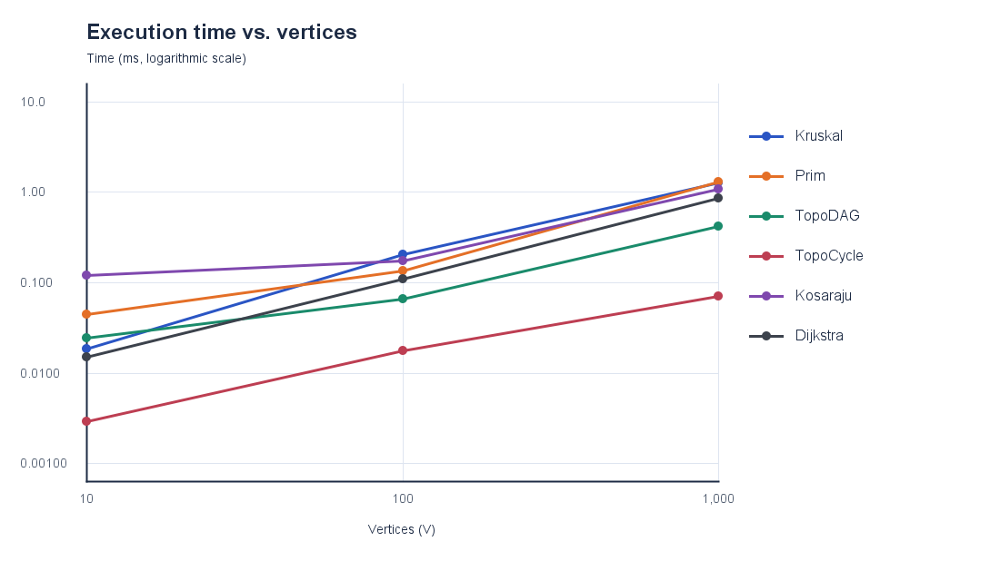
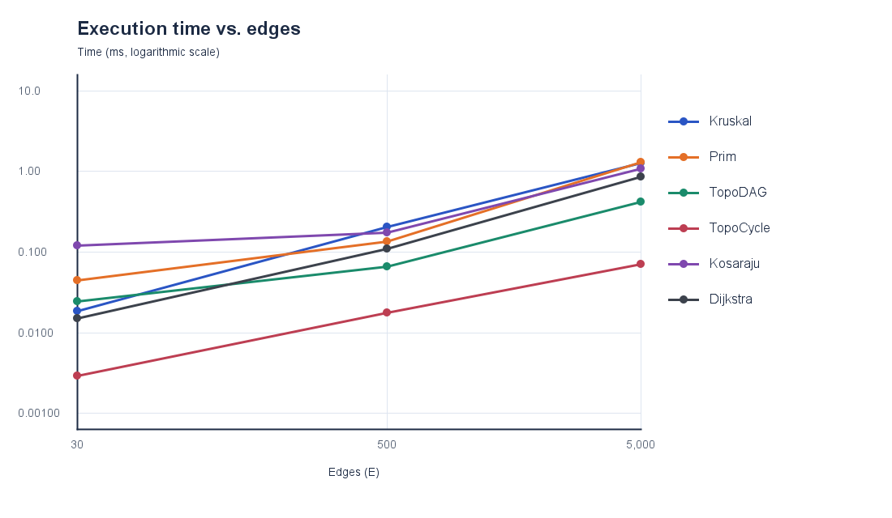

# Assignment 3 — Smart City Infrastructure and Route Planning

Sabyr Aslan · SE-2528 · [GitHub](https://github.com/asikxz008/Assignment3-daa-Aslan)

## Overview

The Java application represents districts as vertices and weighted roads as edges. An adjacency list supports route and connectivity algorithms; a separate edge list supports Kruskal. Undirected graphs model infrastructure costs and travel distances. Directed graphs model one-way connections or dependencies.

Run from the repository root (Java 11 or newer):

```text
javac -d out src/*.java
java -cp out Tests
java -cp out Demo
java -cp out Benchmark
```

`Benchmark` recreates the CSV table and both PNG plots. `Demo` prints MST weights, connectivity, a topological order or cycle result, SCCs, and distances and paths from district 0. For example, its route from 0 to 4 has distance 7 and path `[0, 2, 1, 3, 4]`.

## Implementation

- `Graph` stores non-negative integer weights, an adjacency list, and one canonical copy of each edge. For undirected edges, both traversal directions appear in the adjacency list.
- `DSU` uses path compression and union by size. Kruskal sorts edges and accepts an edge only when it joins two components. Prim grows a minimum spanning forest with a binary priority queue. Both return total weight and a connected flag; a disconnected graph has no MST, so the returned edges form a minimum spanning forest.
- Kahn's algorithm returns a topological order for a DAG and reports a cycle when it cannot process all vertices. Iterative Kosaraju returns every SCC. Dijkstra uses a binary priority queue, non-negative weights, and predecessor links for paths; unreachable vertices have distance `Long.MAX_VALUE` and an empty path. Negative edges are rejected because Dijkstra's greedy choice would not be reliable with them.

## Complexity Analysis

`V` is the number of vertices, `E` the number of edges, and `α` the inverse Ackermann function. Space below is auxiliary space beyond the input graph. Bounds assume adjacency lists and a binary heap; generated graphs have no parallel edges.

| Algorithm | Time | Auxiliary space | Reason |
|---|---:|---:|---|
| DSU `find` / `union` | O(α(V)) amortized | O(V) DSU storage | Compression flattens paths; union by size limits height. |
| Kruskal | O(E log E + E α(V)) | O(V + E) | Sort edges, then use DSU. |
| Prim | O(E log E) | O(V + E) | Each undirected edge enters the lazy priority queue at most once. |
| Topological ordering | O(V + E) | O(V) | Compute indegrees, then remove each ready vertex and scan its edges. |
| Kosaraju SCC | O(V + E) | O(V + E) | Two graph traversals and a reversed adjacency list. |
| Dijkstra | O((V + E) log(V + E)) | O(V + E) | Relax edges with a lazy binary heap; stale entries are skipped. |

For a single DSU call, path compression may take more than constant time; O(α(V)) is a bound over a sequence. The input graph itself uses O(V + E) storage.

## Experimental Setup

| Size | V | E |
|---|---:|---:|
| Small | 10 | 30 |
| Medium | 100 | 500 |
| Large | 1,000 | 5,000 |

For each size, the undirected city starts with a random spanning tree, then receives distinct random edges, so it is connected. The DAG uses only edges from a lower to a higher vertex number. The cyclic directed graph starts with `0→1→2→0`, then receives distinct random directed edges. Weights are in `[1,1000]`. Seeds are `42+V`, `1042+V`, and `2042+V`, respectively; each algorithm uses the same pre-generated graph in every run.

Each algorithm has two untimed warm-ups followed by five timed runs. `System.nanoTime()` measures only the algorithm; graph generation, verification, CSV writing, and plotting are outside timing. The table reports mean milliseconds plus edge scans, key comparisons, DSU calls/parent steps, and queue offers/polls. These counters describe different internal operations and should not be treated as identical units of work.

## Results

Full results: [measurements.csv](results/tables/measurements.csv). The plots use a logarithmic time axis.

| V / E | Kruskal | Prim | Topo DAG | Topo cycle | Kosaraju | Dijkstra |
|---|---:|---:|---:|---:|---:|---:|
| 10 / 30 | 0.018 ms | 0.044 ms | 0.025 ms | 0.003 ms | 0.122 ms | 0.015 ms |
| 100 / 500 | 0.206 ms | 0.136 ms | 0.066 ms | 0.018 ms | 0.175 ms | 0.110 ms |
| 1,000 / 5,000 | 1.288 ms | 1.293 ms | 0.417 ms | 0.070 ms | 1.088 ms | 0.855 ms |





## Comparison and Discussion

Kruskal and Prim found the same MST weight for every connected input. At `V=1,000`, Kruskal examined 2,949 sorted edges and made 55,223 sorting comparisons; Prim scanned 10,000 adjacency entries and made 112,082 heap comparisons. Their recorded times were nearly equal, but the counted operations are different kinds. DSU used 5,898 `find` calls and 5,358 parent steps; path compression and union by size keep this cost close to linear in practice.

Kosaraju scanned exactly `3E` edge entries in this implementation: the original traversal, reversal, and reverse traversal. Its time rose with graph size as predicted by O(V+E). A cyclic topological attempt was faster because Kahn's queue emptied early; on the largest graph it examined 5,014 edges versus 10,000 for the DAG. Dijkstra scanned 10,000 adjacency entries on the largest connected undirected graph and ran more slowly as V and E increased, as expected from edge relaxation and heap operations.

Small timings are sensitive to JVM warm-up, allocation, and timer noise. The required V and E values increase together, so these plots show combined scaling; they do not isolate the effect of changing only V or only E.

## Testing

`Tests` covers a single vertex, disconnected graphs, cycles, multiple valid MSTs with duplicate weights, unreachable vertices, zero-weight edges, invalid vertices, negative-weight rejection, and reproducible generated graphs. It checks equal Kruskal/Prim weights, every edge in each DAG order, every vertex in exactly one SCC, and Dijkstra distances against an independent Bellman–Ford check on generated directed graphs.

## Conclusion

Use Kruskal or Prim to plan a minimum-cost connected network, DSU to track component merges, SCCs to find mutually reachable districts, topological ordering for acyclic dependencies, and Dijkstra for non-negative shortest routes. The measurements match the predicted growth overall, while implementation details affect the exact times.
